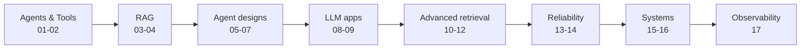

<div align="center">


# Agentic AI Learning

**17 hands-on notebooks that take you from a first tool-calling agent to RAG, memory, multi-agent systems, guardrails, evaluation and observability.**


[Learning path](#-learning-path) · [What's inside](#-whats-inside) · [Highlights](#-highlights) · [Tech stack](#-tech-stack) · [Quickstart](#-quickstart) · [About me](#-about-me)

</div>

---

## Why this repo

Most Agentic AI material stops at a diagram. Here, **every concept is a runnable notebook**: you build it, run it and see the results. Topics follow the order I actually learned them, so the notebooks get steadily harder and each one builds on the last.

- **Learn by running**: one topic per notebook, with outputs saved so you can read results without running anything.
- **One-click start**: every notebook has an *Open in Colab* button.
- **Beyond the demo**: retrieval quality, evaluation, guardrails and observability are covered, not just "make an agent".

## Learning path



## What's inside

| # | Notebook | What you learn | Run |
|---|---|---|---|
| 01 | [Agentic AI, Tools & LangGraph](01_agentic_ai_tools_and_langgraph.ipynb) | Build a tool-using agent: web-search tool, LangGraph state, nodes and edges | [](https://colab.research.google.com/github/AfzalManihar/Agentic-AI-Learning/blob/main/01_agentic_ai_tools_and_langgraph.ipynb) |
| 02 | [LangGraph Memory](02_langgraph_memory_saver.ipynb) | Why every `invoke()` forgets, and how checkpointers + `thread_id` give an agent memory | [](https://colab.research.google.com/github/AfzalManihar/Agentic-AI-Learning/blob/main/02_langgraph_memory_saver.ipynb) |
| 03 | [RAG Agents](03_rag_agents.ipynb) | The two big LLM problems, embeddings, and why retrieval helps | [](https://colab.research.google.com/github/AfzalManihar/Agentic-AI-Learning/blob/main/03_rag_agents.ipynb) |
| 04 | [RAG Pipeline on a Document](04_rag_pipeline_on_document.ipynb) | Chunking, embeddings, a Chroma vector DB, a RAG chain, and RAG with memory | [](https://colab.research.google.com/github/AfzalManihar/Agentic-AI-Learning/blob/main/04_rag_pipeline_on_document.ipynb) |
| 05 | [Multi-Agent Systems](05_multi_agent_systems.ipynb) | Agents that loop over tools and hand work to each other | [](https://colab.research.google.com/github/AfzalManihar/Agentic-AI-Learning/blob/main/05_multi_agent_systems.ipynb) |
| 06 | [Human-in-the-Loop](06_human_in_the_loop.ipynb) | Pause an agent before a tool call so a human can approve or reject it | [](https://colab.research.google.com/github/AfzalManihar/Agentic-AI-Learning/blob/main/06_human_in_the_loop.ipynb) |
| 07 | [ReAct & Plan-and-Execute](07_react_and_plan_execute_agents.ipynb) | Two classic agent designs, compared | [](https://colab.research.google.com/github/AfzalManihar/Agentic-AI-Learning/blob/main/07_react_and_plan_execute_agents.ipynb) |
| 08 | [Streamlit Basics](08_streamlit_basics.ipynb) | Turn Python into a web app, serve it from Colab, see why state is lost | [](https://colab.research.google.com/github/AfzalManihar/Agentic-AI-Learning/blob/main/08_streamlit_basics.ipynb) |
| 09 | [Streamlit LLM App](09_streamlit_llm_app.ipynb) | A real LLM chat app with session state | [](https://colab.research.google.com/github/AfzalManihar/Agentic-AI-Learning/blob/main/09_streamlit_llm_app.ipynb) |
| 10 | [Advanced RAG: Chunking](10_advanced_rag_chunking.ipynb) | Fixed, recursive, sentence, semantic, parent-document and late chunking | [](https://colab.research.google.com/github/AfzalManihar/Agentic-AI-Learning/blob/main/10_advanced_rag_chunking.ipynb) |
| 11 | [Retrieval Methods](11_retrieval_methods.ipynb) | BM25, hybrid search, SPLADE and ColBERT side by side | [](https://colab.research.google.com/github/AfzalManihar/Agentic-AI-Learning/blob/main/11_retrieval_methods.ipynb) |
| 12 | [Self-RAG](12_self_rag.ipynb) | Run the Self-RAG 7B checkpoint and read its reflection tokens | [](https://colab.research.google.com/github/AfzalManihar/Agentic-AI-Learning/blob/main/12_self_rag.ipynb) |
| 13 | [RAG Evaluation](13_rag_evaluation.ipynb) | Faithfulness, answer relevance, context precision/recall, LLM-as-judge | [](https://colab.research.google.com/github/AfzalManihar/Agentic-AI-Learning/blob/main/13_rag_evaluation.ipynb) |
| 14 | [Guardrails](14_guardrails.ipynb) | Input/output guardrails, prompt-injection tests, defence in depth | [](https://colab.research.google.com/github/AfzalManihar/Agentic-AI-Learning/blob/main/14_guardrails.ipynb) |
| 15 | [Multi-Agent Patterns](15_multi_agent_patterns.ipynb) | Supervisor, Swarm and Hierarchical agents on the same task | [](https://colab.research.google.com/github/AfzalManihar/Agentic-AI-Learning/blob/main/15_multi_agent_patterns.ipynb) |
| 16 | [Memory Systems](16_memory_systems.ipynb) | Working, episodic and semantic memory, with the real Mem0 library | [](https://colab.research.google.com/github/AfzalManihar/Agentic-AI-Learning/blob/main/16_memory_systems.ipynb) |
| 17 | [Tracing, Observability & Evals](17_tracing_observability_evals.ipynb) | Trace LLM apps with Langfuse, LangSmith and Phoenix, then evaluate the traces | [](https://colab.research.google.com/github/AfzalManihar/Agentic-AI-Learning/blob/main/17_tracing_observability_evals.ipynb) |

> The original single-file version of all of this is kept as [`Agentic_AI_Complete_Guide.ipynb`](Agentic_AI_Complete_Guide.ipynb).

## Highlights

- **Retrieval shoot-out (11):** BM25, hybrid search, SPLADE and ColBERT on the same documents, so you can see where each one wins.
- **Self-RAG, opened up (12):** loads the `selfrag/selfrag_llama2_7b` checkpoint in 4-bit and shows the reflection tokens that decide *retrieve or not*, *is it relevant*, *is it supported*.
- **Evaluation you can measure (13):** faithfulness (hallucination check), answer relevance, context precision and recall, and an LLM-as-judge.
- **Guardrails that get attacked (14):** NeMo Guardrails and Guardrails AI, tested with prompt-injection and unsafe-content cases.
- **Three ways to organise agents (15):** Supervisor, Swarm and Hierarchical (CEO → Directors → Workers), judged on the same task.
- **Memory, properly (16):** working memory (truncation), episodic memory (chronological vs semantic recall), and semantic memory with Mem0, including memories that expire.
- **Observability (17):** trace a LangChain app and a plain OpenAI-style client, then run evals on the traces.

## Tech stack

| Area | Tools |
|---|---|
| Agents | LangGraph, LangChain |
| LLMs | Groq-hosted `gpt-oss-20b`, `gpt-oss-120b`, `llama-3.3-70b`, `llama-3.1-8b-instant`, Qwen; Self-RAG 7B (local, 4-bit) |
| Retrieval | ChromaDB, sentence-transformers (`all-MiniLM-L6-v2`), Jina embeddings, `rank-bm25`, SPLADE, ColBERT |
| Safety | NeMo Guardrails, Guardrails AI, Llama Prompt Guard |
| Memory | LangGraph checkpointers, Mem0 |
| Observability | Langfuse, LangSmith, Arize Phoenix, OpenTelemetry |
| Apps | Streamlit, ngrok |
| Environment | Google Colab (GPU needed only for notebook 12) |

## Quickstart

**On Colab (recommended)**

1. Click the **Open in Colab** badge next to any notebook above.
2. Add your keys under **Secrets** (key icon, left sidebar) and turn on *Notebook access*.
3. Run the cells from top to bottom. For notebook 12, pick **Runtime → Change runtime type → GPU**.

**Locally**

```bash
git clone https://github.com/AfzalManihar/Agentic-AI-Learning.git
cd Agentic-AI-Learning
python -m venv .venv && source .venv/bin/activate   # Windows: .venv\Scripts\activate
pip install -r requirements.txt
jupyter lab
```

The notebooks were written for Colab and read keys with `google.colab.userdata`. To run locally, replace those lines with environment variables (for example `os.environ["GROQ_API_KEY"]`). `requirements.txt` is an unpinned union of the notebooks' installs; each notebook also installs what it needs in its first cells.

## API keys

| Key | Used for | Where to get it |
|---|---|---|
| `groq_api` / `groq_api3` (Colab Secrets) | LLM calls through Groq | [console.groq.com](https://console.groq.com) |
| `NGROK_AUTH_TOKEN` | Serving the Streamlit apps from Colab (08, 09) | [ngrok.com](https://ngrok.com) |
| Langfuse / LangSmith keys | Tracing demos (17) | [langfuse.com](https://langfuse.com), [smith.langchain.com](https://smith.langchain.com) |

Never commit real keys. `.gitignore` already excludes `.env` files.

## Repository structure

```text
Agentic-AI-Learning/
├── 01_agentic_ai_tools_and_langgraph.ipynb
├── ...
├── 17_tracing_observability_evals.ipynb
├── Agentic_AI_Complete_Guide.ipynb   # everything in one notebook
├── requirements.txt
└── README.md
```

## Use it, fork it

If this helps you learn, **fork the repo, run the notebooks, and adapt them to your own projects**. A ⭐ helps others find it, and issues or pull requests with fixes and ideas are welcome.

## About me

I'm **Afzal Manihar**, a Generative AI and Agentic AI developer. I learn by building, and this repo is the public record of that.

- 💼 Portfolio: [afzalmanihar.github.io](https://afzalmanihar.github.io)
- 💻 GitHub: [@AfzalManihar](https://github.com/AfzalManihar)
- 📩 Email: afzalmanihar429@gmail.com
- 🔗 LinkedIn: https://www.linkedin.com/in/afzal-manihar-bb0183308/

## Acknowledgements

Thanks to **Kartik Gupta Sir** for the guidance and for teaching these concepts through practical, hands-on learning.

## License

Released under the [MIT License](LICENSE).
